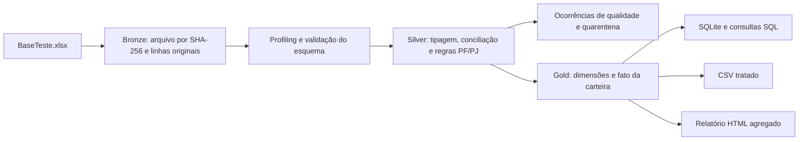

# Arquitetura e proposta de modelagem

A entrega usa Python 3.11 ou superior e SQLite, ambos sem pacotes adicionais. O processamento pode ser executado no computador do avaliador, preserva o arquivo original e entrega uma base tratada, um banco consultável e um relatório. O enunciado pede qualidade de dados para apoiar precificação; os dados disponíveis permitem organizar a carteira e medir suas limitações, mas não calcular um preço de compra com fundamento econômico.

A execução usa `python3 -m pipeline.run --input /caminho/BaseTeste.xlsx --output outputs`. Cada resultado fica em `outputs/<run_id>/`, com ponteiro em `outputs/latest.json`. A fonte fornecida possui 10.740 linhas e a deduplicação resulta em 10.500 registros tratados. As quantidades de APTO, REVISAO e QUARENTENA são calculadas na execução e constam de `qualidade.json` e dos relatórios.

## Fluxo de dados

| Camada | Responsabilidade | Como usar |
|---|---|---|
| Bronze | Guardar a evidência original e a posição da linha/célula. Identificar o arquivo pelo SHA-256. | Reprodução, auditoria e reprocessamento. |
| Silver | Padronizar tipos e formatos, conciliar colunas repetidas, verificar coerência e atribuir um estado de qualidade. | Investigação e correção com acesso restrito. |
| Gold | Representar a carteira no corte e oferecer visões consistentes de consumo. | Análises, BI e preparação da base elegível às regras definidas. |

Na planilha há títulos repetidos: CNPJ cedente, documento, contrato, nome e telefone aparecem em vários blocos. A ingestão deve identificar a coluna pela posição de origem, além de guardar seu título. Usar somente o texto do cabeçalho perderia informações antes mesmo da limpeza.

## Grão e chaves

O grão de `fato_carteira` é **um contrato de um cedente em uma data de corte**. A chave de negócio é `(cedente_id, numero_contrato, data_corte)`. `registro_id` identifica o registro tratado e permite rastrear sua origem. CPF/CNPJ do devedor participa da validação da identidade, mas não substitui o número do contrato.

Essa chave é uma hipótese conservadora a homologar com o cedente. Na exploração foram encontrados três grupos com o mesmo cedente/contrato/corte e devedores diferentes, envolvendo seis identificadores da fonte. A pipeline encaminha esses grupos para quarentena. Incluir o devedor na chave permitiria representar os registros separados, mas também poderia ocultar atribuição incorreta de um contrato; essa alternativa exige confirmação da regra de negócio.

A fato é uma fotografia da carteira, não um livro de pagamentos e nem uma tabela de parcelas individuais. Em cargas de cortes diferentes, somar os saldos sem filtrar o corte duplica a exposição no tempo. Também não se deve transformar quantidade de parcelas em linhas fictícias de pagamento.

| Objeto | Grão e conteúdo | Cuidados |
|---|---|---|
| `dim_cedente` | Um cedente por documento normalizado. | Documento é texto para preservar zeros; validação sintática não comprova a existência da empresa. |
| `dim_devedor` | Uma identidade documental e seu tipo PF/PJ. | Inclui `documento_valido`; não tratar documento inválido como identidade confirmada. Não fundir pessoas por nome. |
| `dim_produto` | Uma combinação de produto e subproduto. | Normalizar caixa e espaços, sem reunir categorias diferentes por semelhança textual. |
| `dim_data` | Uma data civil. | A chave estrangeira materializada na fato é a do corte. As demais datas continuam disponíveis como atributos e podem ser relacionadas à dimensão em consultas. |
| `fato_carteira` | Um contrato por cedente e corte. | Saldos em centavos inteiros, atraso derivado do corte e estado de qualidade. |

Uma evolução do modelo pode separar `devedor_pf` e `devedor_pj` em tabelas vinculadas à identidade principal. Sócios devem ser uma relação própria entre empresa e pessoa; telefone, e-mail e endereço devem aceitar múltiplos contatos. Processos judiciais devem ter relação com o contrato, evitando multiplicar o saldo da dívida quando houver vários processos ou contatos. Esses objetos exigem chaves e regras explícitas antes de se expandir o esquema.

Na implementação atual, esses detalhes permanecem em `registros_tratados`. As tabelas auxiliares implementadas são `linhagem_origem`, `ocorrencias_qualidade`, `perfil_colunas` e `carga`. As chaves técnicas são hashes determinísticos; não devem ser interpretadas como anonimização. Se um documento tiver nomes divergentes, a ocorrência é registrada e o nome de referência da dimensão é escolhido de forma determinística; os valores por registro continuam na Silver.

## Consumo e disponibilização

O banco SQLite é a interface principal para consultas locais. O CSV usa UTF-8 com BOM e delimitador `;`; identificadores devem ser importados como texto e valores monetários mantidos em centavos. Na exportação, textos que começam com `=`, `+`, `-`, `@`, tabulação ou retorno de carro recebem um apóstrofo inicial para evitar interpretação como fórmula. O SQLite mantém o valor canônico sem esse prefixo; consumidores automatizados devem considerar essa convenção ao importar o CSV. Números negativos mantêm o tipo numérico e seu sinal.

O relatório HTML é agregado, funciona offline e não inclui nomes, documentos ou contatos dos devedores. Os links para bases individuais e linhagem exigem o mesmo controle de acesso dos arquivos de destino.

| Objeto de consumo | Uso |
|---|---|
| `vw_carteira` | Carteira analítica com seu estado de qualidade. O consumidor precisa filtrar o corte e decidir como tratar registros em revisão. |
| `vw_precificacao` | Subconjunto com `status_qualidade = 'APTO'`, conforme as regras desta implementação. Ser apto às verificações não equivale a receber aprovação de crédito ou preço recomendado. |
| `vw_carteira_mascarada` | Visão sem nome, documento e contatos para análises que dispensam identificação direta. Identificadores de registro e combinações de atributos ainda podem permitir associação com outras bases. |
| `mart_resumo_carteira` | Agregações por corte, tipo de pessoa, produto, faixa de atraso e estado de qualidade. Inclui quantidades de saldos ausentes e negativos. |
| `vw_quarentena` | Casos com erro impeditivo mantidos na Silver para saneamento. |
| `sql/consultas.sql` | Exemplos de consulta que deixam explícitos o corte, a unidade monetária e o tratamento dos nulos. |

O SQLite e os CSVs com dados individuais devem ficar em pasta com acesso controlado. Compartilhar preferencialmente os agregados ou a visão reduzida. Para uma operação contínua, definir responsável pela base, prazo de retenção, acesso por função e trilha de alterações. Cópias e exportações também precisam seguir essas regras.

## Execução recorrente e operação

O `run_id` é derivado dos hashes da fonte e dos módulos Python, da versão das regras e da seleção de aba. Os metadados registram esses identificadores, arquivo, aba e horário UTC. Cada carga gera um SQLite completo: o histórico é mantido pelos diretórios de carga, e não por inserções incrementais em um warehouse. O banco terá múltiplos cortes somente se a própria fonte os contiver. Somar arquivos de cargas repetidas sem selecionar a versão também duplicaria a carteira.

A cópia Bronze do XLSX é validada pelo SHA-256 e gravada com permissão `0444`. Isso reduz alterações acidentais, mas não substitui controle de acesso. O `manifest.json` inclui os hashes dos artefatos da carga, inclusive o original preservado. Uma repetição da mesma entrada e implementação verifica os hashes existentes e reutiliza a carga; se um artefato foi alterado ou removido, a execução falha, em vez de sobrescrevê-lo silenciosamente. Para reconstruir, deve-se usar outro diretório de saída.

O processamento grava primeiro em uma pasta temporária dentro do diretório de saída. Depois das validações e da gravação dos arquivos, uma renomeação atômica publica a pasta final; o ponteiro `latest.json` também é substituído atomicamente. Uma falha preserva os temporários para diagnóstico e não publica a pasta final. Os controles conferem integridade SQLite e referencial, linhagem, contagem de linhas, separação PF/PJ, chave única, exclusão de erros bloqueantes da Gold e reconciliação dos saldos entre Silver, Gold e quarentena.

O contrato de dados deve verificar as colunas e os blocos esperados antes de transformar. Uma nova coluna, coluna removida ou mudança de ordem exige avaliação do mapeamento. Não aplicar silenciosamente a posição antiga sobre um novo layout.

O acompanhamento pode usar quatro grupos de métricas: volume por carga, completude de campos críticos, quantidade de ocorrências por regra e distribuição entre APTO/REVISAO/QUARENTENA. Definir limites com o responsável pelo dado após observar a série histórica; um limite arbitrário pode esconder uma mudança real da carteira.

## Evolução conforme a necessidade

| Necessidade observada | Evolução sugerida | Critério para adotar |
|---|---|---|
| Mais arquivos ou histórico que torne a varredura local lenta | Bronze particionada por origem/carga e Silver/Gold em Parquet. | Medir volume, tempo de processamento e custo de releitura. Manter o original e a linhagem. |
| Vários usuários consultando e atualizando ao mesmo tempo | PostgreSQL ou um warehouse gerenciado. | Necessidade de concorrência, controle de acesso e serviço disponível continuamente. |
| Transformações SQL compartilhadas por uma equipe | Modelos e testes com dbt. | Crescimento do número de modelos, dependências e mudanças revisadas em conjunto. |
| Muitas fontes, dependências e tentativas automáticas | Orquestração com Airflow ou serviço equivalente. | Agenda com várias etapas, recuperação de falhas e necessidade de monitoramento central. Uma única carga local não exige essa infraestrutura. |
| Painéis para usuários de negócio | Power BI ou outra ferramenta de BI sobre o banco/warehouse. | Atualização recorrente, definição de indicadores e acesso por perfil. Filtrar corte e qualidade no modelo semântico. |
| Consulta por sistemas externos | API sobre as tabelas de consumo. | Contrato de campos, autenticação, limites de acesso e necessidade real de integração. Evitar publicar diretamente o arquivo bruto. |

Essas são opções de evolução, não dependências da entrega local. Uma migração precisa preservar as regras de negócio e os testes de reconciliação.

## O que falta para precificar

Para estimar recuperação ou preço de aquisição seriam necessários, no mínimo, históricos de recebimentos vinculados aos contratos e às datas, custos de cobrança, estratégia aplicada, condições jurídicas e de garantia verificadas e definição do resultado que se quer prever. Treinamento e avaliação precisariam respeitar o tempo e impedir que informação posterior ao corte entre como variável explicativa.

A base atual permite segmentar exposição por atraso, produto e perfil, além de medir a qualidade dos campos. Não permite inferir probabilidade de recuperação, taxa de desconto ou valor justo apenas com a fotografia disponível.

## Referências técnicas

A escolha de SQLite para análise local segue os cenários descritos na [documentação oficial do SQLite](https://www.sqlite.org/whentouse.html). A separação entre fatos e dimensões se apoia nos conceitos de granularidade e relacionamento da [documentação de modelagem estrela da Microsoft](https://learn.microsoft.com/en-us/power-bi/guidance/star-schema). A conversão monetária usa a aritmética decimal documentada pelo [Python](https://docs.python.org/3/library/decimal.html), com armazenamento final em centavos inteiros.
