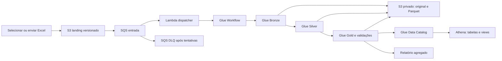

# Pipeline na AWS

A arquitetura executa o tratamento nos serviços solicitados: **Glue para processamento, S3 para armazenamento, tabelas do Glue Data Catalog consultáveis no Athena e Glue Workflow para orquestração**. A Lambda apenas transforma o evento de entrada em uma chamada para iniciar o workflow; nenhuma limpeza é executada nela.

A execução real e as contagens verificadas no Athena estão registradas em [validacao-aws.md](validacao-aws.md).



## Componentes implantados

| Componente | Implementação |
|---|---|
| S3 | Três buckets: dados, artefatos de código e resultados do Athena. Versionamento, bloqueio público, criptografia SSE-S3 e exigência de TLS. |
| Bronze | Job Glue baixa a versão exata do Excel, preserva o original por SHA-256, valida as 79 posições e escreve linhas originais em Parquet. |
| Silver | Spark aplica `pipeline.cleaning.Cleaner` por partição, deduplica, reconcilia identidades, classifica qualidade e produz ocorrências, linhagem e quarentena. |
| Gold | Spark constrói fato e dimensões, calcula agregados, valida contagens/chaves/saldos e escreve Parquet Snappy. Não usa SQLite. |
| Catálogo | Quatro databases: Bronze, Silver, Gold e controle. Quatorze tabelas com schema explícito e partição `load_id`. Não depende de crawler ou `MSCK REPAIR TABLE`. |
| Athena | Workgroup com resultados criptografados, métricas e limite de 1 GiB lido por consulta. Views criadas automaticamente na implantação. |
| Glue Workflow | Três jobs sequenciais. Silver só inicia após Bronze ter sucesso; Gold só inicia após Silver. Uma execução simultânea, timeout de 30 minutos por job e uma repetição automática por job. |
| Entrada | Notificação `ObjectCreated` de `landing/*.xlsx` → SQS → Lambda. A fila aguarda quando o workflow estiver ocupado. Falhas de entrega seguem para DLQ após as tentativas configuradas. |
| Operação | Logs Glue/Lambda no CloudWatch, alarme para mensagens na DLQ, métricas, versão de código e manifesto por carga. |

Os jobs usam **AWS Glue 5.0 / Spark 3.5.4 / Python 3.11**, com dois workers G.1X por padrão. O código próprio é um ZIP imutável por SHA-256 em `--extra-py-files`; não há instalação de pacotes do PyPI durante as cargas. A imagem oficial do Glue permite testar o mesmo runtime localmente. [Runtimes oficiais](https://docs.aws.amazon.com/glue/latest/dg/release-notes.html), [bibliotecas no Glue](https://docs.aws.amazon.com/glue/latest/dg/aws-glue-programming-python-libraries.html).

## Código de cada job

Cada etapa contém sua implementação diretamente no arquivo executado pelo Glue:

| Arquivo | Implementação |
|---|---|
| `cloud/jobs/bronze.py` | Leitura da versão S3, validação do Excel, preservação do original, criação do DataFrame e escrita Bronze. |
| `cloud/jobs/silver.py` | `clean_partition`, `build_silver` e execução Silver: PySpark para limpeza, deduplicação, conflitos, qualidade e linhagem. |
| `cloud/jobs/gold.py` | `build_gold`, `validate`, `publish` e execução Gold: fatos, dimensões, agregados, validações e publicação no catálogo. |

As funções são chamadas dentro do próprio job. `runtime.py` compartilha a sessão Spark e o acesso a S3/Glue; `contracts.py` compartilha os schemas; `pipeline/cleaning.py` e os parsers compartilham as regras de normalização com a execução local.

## Implantar em uma conta nova

Requisitos locais: AWS CLI v2, Terraform 1.10+ e Python 3.11+. O perfil precisa poder criar os recursos declarados em `infra/terraform/`; para equipes, aplique uma política de implantação revisada pela administração da conta.

1. Autentique o perfil na conta de destino. Com uma versão recente do AWS CLI, `aws login` permite autenticação pelo navegador sem compartilhar chaves na conversa. [Documentação de login](https://docs.aws.amazon.com/cli/latest/userguide/cli-configure-sign-in.html).
2. Execute o deploy com o ID explícito da conta. O script verifica STS antes de qualquer criação e o provider Terraform aceita somente essa conta.
3. O script empacota o código, valida o Terraform, gera o plano, aplica os recursos e cria as views no Athena. Salva nomes e região em `build/aws/deployment.json`.

```bash
aws login --profile poc-aws --region us-east-1
aws sts get-caller-identity --profile poc-aws

# Somente plano, sem criar recursos:
python3 tools/deploy_aws.py --profile poc-aws --account-id 123456789012 --plan-only

# Criar a infraestrutura e as views:
python3 tools/deploy_aws.py --profile poc-aws --account-id 123456789012
```

Substitua `123456789012` pelo ID autorizado. A região padrão é `us-east-1`; use `--region` para mudar antes da primeira implantação. Não altere região/conta de uma instalação existente sem revisar o estado do Terraform.

O login recente do AWS CLI é utilizado pelo deploy por credenciais temporárias passadas **somente na memória** aos subprocessos Terraform. O código não grava nem imprime access keys. O estado do Terraform é local nesta entrega e está excluído do Git; para trabalho em equipe, migre o backend para armazenamento remoto com controle de acesso e locking.

O trigger de entrada é `ON_DEMAND` com `enabled=false` no Terraform: a execução começa por `StartWorkflowRun`, com as propriedades da fonte, e não na criação dos recursos. O dispatcher tem leitura de recibos e `ListBucket` apenas no bucket do projeto; essa permissão permite distinguir recibo ausente (404) de acesso negado (403) ao consultar metadados S3.

Terraform cria recursos que podem gerar cobrança conforme uso. Glue executa computação por job; S3, Athena, filas e logs também têm suas próprias métricas de cobrança. Esta entrega configura limites de execução e consulta, sem presumir custo zero. Para retenção, os resultados do Athena expiram após 30 dias e logs Lambda após 14 dias; originais e camadas do lake não têm expiração automática.

## Usar: somente informar o arquivo

No macOS, dê dois cliques em `Iniciar Pipeline AWS.command`. O seletor solicita o Excel e o comando acompanha o workflow até baixar e abrir o relatório agregado. Alternativa pelo terminal:

```bash
python3 tools/enviar_aws.py "/caminho/BaseTeste.xlsx" --profile poc-aws
```

Também é possível fazer upload pelo console do S3 no bucket de dados, sob **`landing/`**, usando extensão minúscula **`.xlsx`**. A notificação inicia a mesma pipeline. Os resultados e o relatório permanecem no S3; as tabelas ficam consultáveis no Athena após a validação.

A conversão de XLSX é a única etapa não distribuída: o formato ZIP/XML precisa ser aberto por um leitor antes de produzir linhas. A carga suporta até **64 MiB e 250 mil linhas** por arquivo, limites configuráveis no Terraform. A transformação, os agrupamentos, as validações e a escrita em Parquet são executados pelo Spark. Para volumes maiores, prefira receber arquivos já tabulares/particionáveis em outra evolução do contrato.

## Organização no S3 e publicação

```text
landing/<sha-do-arquivo>.xlsx                # entrada versionada
bronze/originals/<sha-do-arquivo>.xlsx        # evidência preservada
runs/<workflow_run_id>/bronze/<tabela>/      # Parquet
runs/<workflow_run_id>/silver/<tabela>/      # Parquet
runs/<workflow_run_id>/gold/<tabela>/        # Parquet
runs/<workflow_run_id>/control/              # controle Parquet
runs/<workflow_run_id>/meta/                 # metadados e ready.json
control/commits/<load_id>.json               # manifesto completo
control/sources/<source_id>.json             # recibo do objeto/versão
reports/<load_id>/relatorio.html
reports/<load_id>/qualidade.json
```

`source_id` identifica bucket, chave, versão S3 e release. `load_id` identifica conteúdo, release e aba. Assim, reenvio do mesmo conteúdo com a mesma release não duplica a carteira publicada. A versão S3 do evento é lida explicitamente, evitando trocar o arquivo quando a chave recebe outro upload.

As tabelas físicas usam partições `load_id` com localização explícita nos respectivos diretórios de execução. A Gold é validada antes de registrar partições. `cargas_publicadas` é registrada por último; as **views de consumo** fazem join com esse controle, evitando expor cargas incompletas. Tabelas físicas de histórico são interfaces de auditoria e podem mostrar partições intermediárias; os consumidores devem usar as views.

Após gravar `ready.json`, uma repetição da publicação retoma somente o registro de catálogo/manifesto, sem sobrescrever os dados já prontos. Notificações S3/SQS podem se repetir: o dispatcher reconhece fontes concluídas e os jobs reconhecem cargas concluídas. Isso é importante porque a entrega de eventos é ao menos uma vez. [S3 notifications](https://docs.aws.amazon.com/AmazonS3/latest/userguide/notification-how-to-event-types-and-destinations.html), [Lambda com SQS](https://docs.aws.amazon.com/lambda/latest/dg/with-sqs.html).

## Consultar no Athena

Selecione o workgroup `poc-carteira-dev` e o database `poc_carteira_dev_gold` na configuração padrão. Nomes efetivos constam de `build/aws/deployment.json`.

```sql
SELECT status_qualidade, COUNT(*) AS registros,
       SUM(valor_contabil_centavos) AS saldo_centavos
FROM vw_carteira_atual
GROUP BY status_qualidade;

SELECT produto, COUNT(*) AS contratos,
       SUM(valor_contabil_centavos) AS saldo_centavos
FROM vw_precificacao_atual
GROUP BY produto;
```

Use `vw_carteira_atual` para a última **carga publicada**, e `vw_precificacao_atual` para o subconjunto APTO. Isso não representa um cadastro consolidado de todos os arquivos enviados: cada entrada é uma fotografia completa da fonte. `vw_carteira` mantém o histórico de todas as cargas; filtre `load_id` para não contar reprocessamentos como dívidas novas. Datas de corte vêm do arquivo e os valores monetários continuam em centavos inteiros. `sql/athena_consultas.sql` contém outros exemplos.

Bronze e Silver contêm dados pessoais, assim como dimensões identificadas. O bloqueio de acesso público não substitui permissões de consumo: conceda acesso IAM somente aos databases e prefixos necessários. A view mascarada remove identificação direta, mas não equivale a anonimização nem garante restrição se o usuário também tem acesso às tabelas-base. Use perfis de consumo/Lake Formation conforme as necessidades de acesso da equipe.

## Falhas e retomada

- **Workflow ocupado:** SQS aguarda e tenta novamente; nenhuma escolha manual de arquivo é necessária.
- **Falha de job:** a etapa é repetida uma vez. Se persistir, a etapa posterior não inicia e a carga não é liberada pelas views. Investigue os logs e corrija a causa antes de reenviar a fonte.
- **Falha de entrega ou autorização do dispatcher:** a mensagem continua na fila e pode ir à DLQ; existe alarme no CloudWatch, sem destinatários externos configurados.
- **Falha após os dados estarem prontos:** a publicação retoma a partir de `ready.json`.
- **Timeout do cliente local:** o job AWS pode continuar; consulte o Glue Workflow e o manifesto em S3 antes de reenviar.
- **Atualizar código:** execute novamente o deploy, preferencialmente sem workflow em execução. O pacote muda por hash. Mudanças de schema exigem planejamento de migração das partições históricas.

## Verificação e limites

```bash
make test
python3 tools/package_aws.py
terraform -chdir=infra/terraform fmt -check -recursive
```

`tests_aws` verifica contratos, idempotência do roteamento, versão de objeto, erros preservados na fila, publicação do controle por último e relatório sem HTML injetado. `tools/smoke_spark.py` verifica as transformações e leitura/escrita Parquet na imagem oficial do Glue. A implantação também valida Terraform e cada execução valida contagens, grão, chaves, status, PF/PJ e reconciliação de saldos antes da publicação.

Para acompanhar a execução e verificar os dados pelo Athena real:

```bash
python3 tools/status_aws.py --profile poc-aws
python3 tools/verificar_aws.py --profile poc-aws
```

O verificador compara as contagens de Bronze, Silver, Gold, aptos e quarentena com o manifesto e reconcilia as três medidas monetárias por consultas SQL no Athena. Ele deve ser executado após a publicação da carga.

Os arquivos de infraestrutura descrevem a implantação; a confirmação de execução real precisa vir dos serviços (Glue, S3 e consulta Athena). Não considere uma validação local como prova de que um workflow na conta AWS teve sucesso.

## Refatoração e operação de releases

Os 14 objetos físicos incluem três marts Gold com definições compartilhadas com o SQLite. Valores individuais usam centavos inteiros de 64 bits; somas dos marts usam `DECIMAL(38,0)` no Spark/Athena. O SQLite materializa essas somas como texto decimal exato para não exceder seu limite de inteiro. Médias e percentuais são calculados com denominador explícito na apresentação.

Bronze lê a planilha em streaming antes da conversão Spark; Silver interpreta o resultado das regras uma vez; Gold usa hashes nativos, dimensões com validação de unicidade e referências e ações consolidadas para reconciliação. `shuffle_partitions` e `output_partitions` são parâmetros Terraform ajustáveis ao volume. A configuração inicial pequena deve ser medida novamente ao aumentar arquivos ou concorrência.

A publicação registra um ponteiro de preparação imutável antes das partições. Tentativas seguintes reutilizam a localização original, sem redirecionar partições publicadas. O controle continua sendo registrado por último. O deploy recusa workflows ou jobs ativos (incluindo tentativas) e mensagens pendentes na fila antes de planejar e aplicar; essa verificação não é um bloqueio atômico de novos uploads. Faça atualizações em janela sem novas entradas e com a fila drenada.

O workgroup `-bi` e a política `-bi-read` são preparados para consultas dos marts e controle, com resultados separados em `results/bi/`. A política não é anexada automaticamente. Conexão de BI e permissões efetivas de uma identidade consumidora precisam de configuração própria; a implantação não publica um dashboard externo.

```bash
python3 tools/verificar_aws.py --profile poc-aws
python3 tools/exportar_aws.py --profile poc-aws --dataset todos
```

A verificação confere a release, contagens, universos analíticos e reconciliação financeira dos marts com a fato e a Silver. Não considera uma carga de uma release antiga como validação da nova implantação.

O SDK do Glue pode ter um modelo de `PutObject` anterior ao suporte ao argumento `IfNoneMatch`. O runtime detecta esse caso e adiciona `If-None-Match: *` antes da assinatura da requisição. A condição continua sendo aplicada no S3, conforme a [documentação de escrita condicional](https://docs.aws.amazon.com/AmazonS3/latest/userguide/conditional-writes.html). O teste `test_sdk_compat.py` verifica a requisição assinada no SDK da imagem Glue, sem serviços externos.

## Entrega contínua

A `main` é publicada automaticamente pelo GitHub Actions após as verificações. O estado da instalação passou a usar o backend S3 versionado e com lock nativo; o comando de deploy local também utiliza esse backend. Consulte [cicd.md](cicd.md) para autenticação OIDC, bootstrap, conferências e operação.
